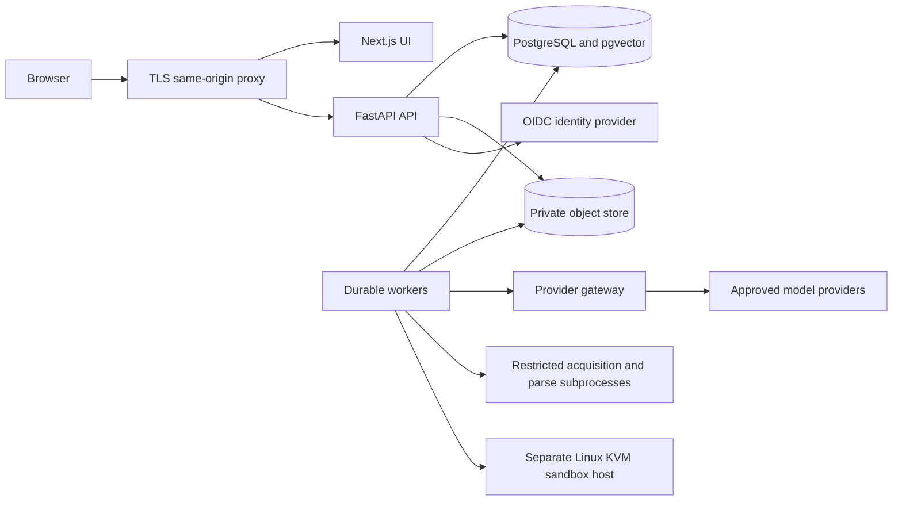

# System architecture

Date: 2026-11-17. M01 proposed V1 specification; owner: M01 system/RAG/operations author.
Baseline inspected: `f8c967f66e72927683c77f4cd45869f165251156`.
Separate review and human acceptance are required. Nothing here asserts deployed capacity.
This milestone authorizes specifications only; current expenditure authorization is $0.

## Authority and scope

[SRS](../requirements/SRS.md) owns FR/NFR requirements; [API contracts](API_CONTRACTS.md)
and [data model](DATA_MODEL.md) own wire/schema details. See [security](SECURITY_MODEL.md),
[RAG](RAG_ARCHITECTURE.md), [learning](../learning/LEARNING_ENGINE.md), and
[operations](../operations/OPERATIONS.md) for their respective boundaries.
V1 proposes adult self-directed learners, English HTML/text PDFs, and Python standard
library exercises, pending human acceptance. No institutions, sharing, OCR, model
training, arbitrary user tools, or arbitrary provider endpoints are in V1.

## Deployment and responsibility

One modular Python/FastAPI codebase runs API and worker processes separately. A
Next.js TypeScript UI uses the same-origin API through a TLS reverse proxy. PostgreSQL
stores authoritative state, durable jobs, lexical indexes, and pgvector embeddings.
A private S3-compatible object store holds immutable input/output artifacts. No Redis,
separate vector service, message broker, or orchestration cluster is required initially.
Exact package versions, hosting, identity provider, model adapters, and object-store
implementation are release decisions; open-source availability does not imply free hosting.

Arrows are logical dependencies, not permission to expose services publicly. Only the
proxy is public. The acquisition subprocess has controlled public HTTP egress; the
parser has no network. The sandbox guest has neither network nor application secrets.
Provider credentials are accessible only to the gateway execution path. No learner
code runs on the application host. Database/object storage are private to trusted roles.

| Module | Owns | Required interface and invariant |
| --- | --- | --- |
| Identity | Users, opaque sessions, OIDC linkage | Authenticate and authorize before any owned lookup; email verified |
| Workspaces | Goals and revisions, archive state | Expected-revision writes; owner only |
| Sources | Discovery, approval, acquisition, version publication | Approval binds content version; permissions are independently checked |
| Knowledge | Sections, passages, embedding generations, retrieval | Only approved active workspace versions; provenance on every hit |
| Learning | Pathway, tutor, exercises, assessment, progress | Durable versioned evidence; never infer mastery from activity alone |
| Gateway | Bindings, encrypted credentials, reservations, calls | Explicit consent and atomic budget admission before provider dispatch |
| Jobs | Leasing, cancellation, retries, fencing | At-least-once execution; idempotent durable effects |
| Privacy | Export, deletion, tombstones | Immediate deny, asynchronous purge and restore suppression |
| Execution | Sandbox requests and signed result envelopes | Isolated bounded execution; unavailable sandbox fails closed |

Modules call explicit services/repositories; they do not update another module's tables
ad hoc. Cross-module atomic operations use one database transaction orchestrated by a
small application service. There is no requirement to distribute these modules into
services. Unit tests cover domain decisions; integration tests exercise real transaction
and permission behavior. The proposed repository layout is `backend/app/<module>`,
`backend/tests`, `frontend`, and `infra` when implementation is authorized.

## Identity and isolation (FR-001, FR-002, FR-029)

Use external OIDC authorization code with PKCE, state/nonce checks, and verified email;
no local password database. API exchanges identity for opaque server-side sessions;
HttpOnly Secure SameSite=Lax cookie, CSRF protection on mutations, session expiry and
revocation are server-enforced. Next.js presentation state never authorizes an action.
Account linking requires authenticated proof; matching email alone must not merge accounts.

Each owned object carries workspace/user ownership; composite foreign keys prevent
cross-workspace links. API derives identity from the session, never a submitted owner ID.
Use a non-owner, non-superuser, non-BYPASSRLS application role, enabled row security,
and transaction-local authenticated context. Worker context comes from the durable job's
validated owner, not arbitrary payload fields. Reset context through transaction scope;
connection-pool reuse tests must demonstrate no identity carryover. Unauthenticated or
missing context denies access. PostgreSQL owners normally bypass row security, so migration
and administrative roles must not be used by request workers. [PostgreSQL row security](https://www.postgresql.org/docs/current/ddl-rowsecurity.html)
supports this defense but does not replace application authorization or storage checks.

Object paths are opaque IDs, never authorization evidence. Download handlers authorize
live ownership and deletion state each time. Prefer authenticated proxy delivery for
content so revocation does not depend on signed URL expiry. Citation and job endpoints
apply the same controls as normal records. Exports require fresh authentication.

## Durable work and concurrency (FR-008, FR-014, FR-026)

An accepted command and its job are inserted in the same transaction; a 202 response
is returned only after commit. Status/result polling is the V1 asynchronous protocol;
no token streaming is required. FastAPI background callbacks are not the durable queue.
Its documentation distinguishes small process-local background work from heavier task
execution; durable recovery is this design's additional obligation.
[FastAPI background tasks](https://fastapi.tiangolo.com/tutorial/background-tasks/)

Workers claim eligible rows using `FOR UPDATE SKIP LOCKED`, increment a fencing token,
and record a 30-second lease using database time. Heartbeats renew every 10 seconds
only while owner/token match. PostgreSQL documents SKIP LOCKED as useful for queue-like
consumers, although it gives an inconsistent view unsuitable for general queries.
[SELECT locking clauses](https://www.postgresql.org/docs/current/sql-select.html)
Never hold a database transaction open during network/model/parser execution.

Job states: `queued -> running -> succeeded|failed|cancelled`, with transient failures
passing through `retry_wait -> running`. At most three retries after the initial attempt,
with persisted delays 1, 5, 30 seconds; use provider Retry-After if longer, bounded by
operation deadline. Jobs store attempt count, not-before, lease owner/expiry, fencing
value, cancellation flag, redacted error category, input revision, and durable step outputs.
Expired leases are recoverable, but every write/publish checks fencing token and current
resource state. A stale worker cannot finalize even if its external process completes.

Idempotency keys are scoped to authenticated principal, route/operation, and request
hash. Same key/hash returns the original operation; changed payload conflicts. Internal
step uniqueness prevents duplicate passages, attempts, progress events, and charges.
Replay rechecks live ownership, deletion and source visibility before returning data.
Persist content-free operation references and regenerate the current authorized
representation without re-executing the operation. Deleted/revoked excerpts must not
survive in replay responses; retained sensitive replay bodies join the purge inventory.
Duplicate execution is possible; exactly-once provider execution is not promised.
Cancellation stops queued work and requests termination of running work; it cannot undo
already sent provider requests. Never claim cancellation guarantees no provider bill.

Tutor submission locks the session briefly, checks expected revision and one-active-turn
constraint, then persists user input and job. Completion commits assistant turn and the
new revision atomically. A competing tab receives a conflict and must reload; it does not
automatically resend. Source epoch and account/workspace deletion state are checked both
before completion and when rendering. A changed epoch invalidates pending evidence and
requires fresh retrieval/turn retry, with new billable work requiring budget admission.

## Storage and publication (FR-007, FR-009, FR-010, FR-023, FR-024)

Fetch/upload writes a bounded staging object, computes SHA-256, validates actual type,
and records immutable artifact metadata. Parsing, chunking, and embeddings produce
staged rows tied to one immutable source version. Publish only after all selected pipeline
stages pass: one transaction checks approval, rights, deletion flag, current expected
source revision, quota reservation, and worker fence, then swaps the active version
pointer and increments workspace source epoch. Partial versions are never searchable.
Failed refresh preserves the prior active version. If rights expire or approval is revoked,
access stops immediately regardless of whether a replacement is ready.

Database and object store do not share a transaction. Immutable object existence/checksum
is checked before publication; missing objects block publication. A reconciler removes
unreferenced staging objects after a grace period exceeding the job deadline and audits
published references for missing objects. Concurrent refreshes require source revision
comparison; the loser is retained as failed/superseded staging, not silently published.
Deletion immediately denies reads and fences jobs, then purges content, derived text,
embeddings, caches and exports. Citation tombstones preserve only non-content identifiers.

## Gateway and cost admission (FR-020, FR-021, FR-022)

Expose internal capabilities `chat`, `embed`, and optional provider health/credential test,
not provider-specific SDKs throughout the application. Each adapter declares provider/model
identity, allowed operation, input/output limits, token counting behavior, price snapshot,
timeouts, usage fields, and idempotency/reconciliation support. Only fixed allowlisted
endpoints and TLS are allowed. A capability binding records platform or BYOK mode,
credential reference, model, consent revision, and approved data categories.
Changing the binding does not mutate existing embedding generations or historical calls.

A credential can be saved, tested, revoked, or deleted; plaintext is never returned.
Tests may themselves be billable and require admission. The gateway decrypts only for
an admitted call, never persists plaintext, and applies the revocation ordering below. Encrypted storage alone
is insufficient: key separation, rotation and access audit are specified in security.

Before each call, atomically lock budget ledgers in deployment/owner/credential order,
then affected bindings and credential rows in stable ID order. Binding changes and
credential revocation/replacement take the same relevant locks in that order. Under
these locks verify current consent, binding/credential version and nonrevoked state,
reserve a conservative maximum cost using input size and capped output, and commit
the call intent with state `dispatched`. This commit linearizes dispatch admission.
Revocation committed first blocks admission; admission committed first permits that
request to transmit or bill later, with only best-effort cancellation. Network I/O
occurs after commit, with no DB locks held. Test both race orderings, including a pause
between admission commit and transmission. Missing price/limit information fails admission. Budget
D defaults to $0; no paid platform dispatch occurs until numeric caps and provider capacity
are approved. BYOK requires explicit user billing consent and local caps. Local limits cannot
guarantee a provider-wide bill ceiling, particularly with calls outside this application.

Call accounting states are `reserved`, `dispatched`, `succeeded`, `failed`, or `unknown`;
they are distinct from job states. `dispatched` records committed admission before
external I/O, not confirmed transmission. A crash between that commit and transmission
is conservatively ambiguous. Settle reported usage once;
retain the maximum reservation for unknown outcomes until verified provider reconciliation
or documented conservative settlement. Never release an unknown reservation merely on a
job timeout. Never blindly retry an ambiguous billable request. Known pre-dispatch failures
release the reservation; retryable confirmed non-executed failures need new admission.
No cross-provider, paid, or BYOK fallback without explicit applicable consent. Chat/embed
outages yield a durable understandable failure, preserving prior work.

## Execution boundary (FR-017)

The execution broker accepts only approved exercise/attempt IDs and bounded code; the
worker fetches authorized test definitions and submits a minimal request to a separate
Linux KVM host. Firecracker is a candidate because it provides KVM-based microVM isolation;
this is not proof of deployment security or available hardware.
[Firecracker project](https://firecracker-microvm.github.io/)

Each run gets a fresh pinned Python image, no guest network, no application keys/database,
read-only base, 10 MiB writable space, 256 MiB memory, 16 processes, 2 seconds CPU,
5 seconds wall time, 32 KiB submitted code and 64 KiB combined output. Enforce quotas at
the host boundary, terminate the entire guest on expiry, and sanitize terminal output.
Hidden tests must not reside in learner-readable files; an external trusted harness checks
results, and tests must be designed for the threat model. A run cannot self-report a grade.
Record image/test hashes, limits and termination reason. If host isolation or quota tests
fail, disable code execution; do not fall back to a subprocess on the API/worker host.

## Alternatives, feasibility and release gates

| Decision | Alternative and tradeoff | Revisit trigger |
| --- | --- | --- |
| Modular monolith | Microservices add independently scalable ownership but distributed consistency/operations | Measured bottleneck or separate team ownership |
| Python/FastAPI | Proposed for typed service contracts alongside Python retrieval code; Django is an alternative when integrated administration and its application conventions outweigh a smaller API surface | Reassess against actual authentication, migration and operator needs before dependency lock |
| Next.js/TypeScript | Proposed for routing and a unified UI deployment; a static SPA removes the UI server but leaves routing/build and same-origin API deployment choices to the team | Use a SPA if server rendering has no demonstrated product need and deployment is simpler |
| PostgreSQL jobs | Dedicated broker improves queue features but adds durability boundary and service | Measured contention/queue latency after query tuning |
| PostgreSQL/pgvector | One authority coordinates ownership, deletion and vector metadata; a dedicated vector database adds a separate synchronization and recovery boundary | Measured filtered-recall, index or latency gap after query tuning |
| Private object storage | Keeps immutable source/export bytes outside relational rows; DB blobs simplify atomic references but enlarge DB backup/restore scope; object storage requires orphan reconciliation | Measured artifact volume, restore cost or hosting constraints justify a different byte store |
| Thin provider adapters | Explicit typed calls keep consent, retry and spending decisions in application code; an orchestration framework may reduce integration work but its retry/tool defaults require the same controls | Repeated adapter work justifies a reviewed dependency without weakening gateway authority |
| OpenTelemetry instrumentation | Proposed common trace/metric instrumentation with an explicitly selected exporter; bespoke logs are simpler initially but require custom correlation. Neither choice authorizes an external telemetry service or content capture | Select minimal pinned instrumentation/export path after redaction, retention, runtime cost and hosting review |
| Polling durable turns | Streaming improves perceived responsiveness but risks partial unverified output | Safe buffered streaming design and accessibility tests |
| KVM execution | Containers alone are simpler but share the host kernel | Independently reviewed alternative isolation |
| External OIDC | Local credentials avoid identity vendor dependency but add password recovery/security work | Hosting/identity feasibility cannot meet release needs |

Initial proposed envelope: 100 accounts, 20 concurrent sessions, 5 workspaces/account,
20 sources/workspace; 50 MiB, 1,000 pages and 500,000 extracted tokens/source;
100,000 passages/workspace and 1,000,000 deployment-wide. Quotas are independent limits,
not a promise that all account maxima fit simultaneously. At full source maxima, 10,000
files alone approach 488 GiB before replicas, extracted data and backups. Capacity admission
must enforce both per-owner and global limits; no assumption of free storage is acceptable.

Resource/load/latency gates are in operations. M02 proves identity/ownership/transactions;
M03 proves source approval/publication; M04 retrieval correctness; M05-06 durable teaching
and evidence; M07 execution isolation; M08 restore/load/privacy release readiness.
[T-FR-001..030 and T-NFR-001..012](../testing/TEST_STRATEGY.md) are proposed evidence,
not completed tests. Unresolved hosting, provider funding, sandbox hardware, parser quality,
and reviewer findings can block release even when the design is accepted.
